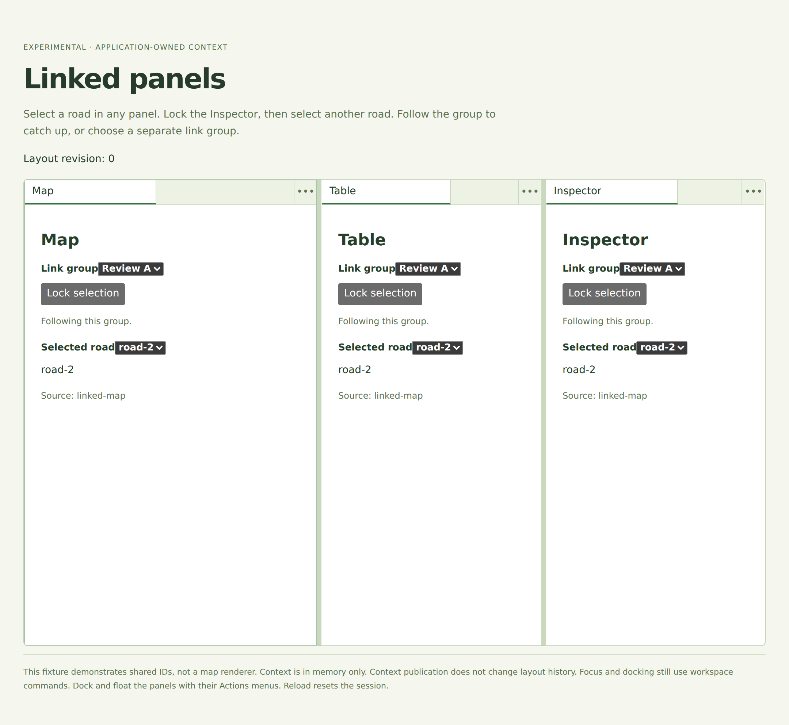

# PR #49: linked-panel screenshot evidence

Source: `e2c70426dbf6ebbd998a08f7bf9f2409848d4bcd`.

Real Chromium screenshots after UI interactions and assertions. No DOM replacement, mock data injection, CSS overrides, or image editing.

[Capture run](https://github.com/natanelia/panefold/actions/runs/39551520733)

## 1. Map publishes road-2; Table and Inspector follow in Review A.

## 2. Map and Table show road-3; locked Inspector keeps road-2 and its road control is disabled.

## 3. Follow group immediately catches Inspector up to road-3 and enables its road control.

## 4. Inspector publishes road-1 in Review B. Map and Table remain on road-2 in Review A.

## 5. Returning Inspector to Review A adopts its latest road-2 selection and Map source.

See capture.json for asserted panel states and PNG SHA-256 checksums.
